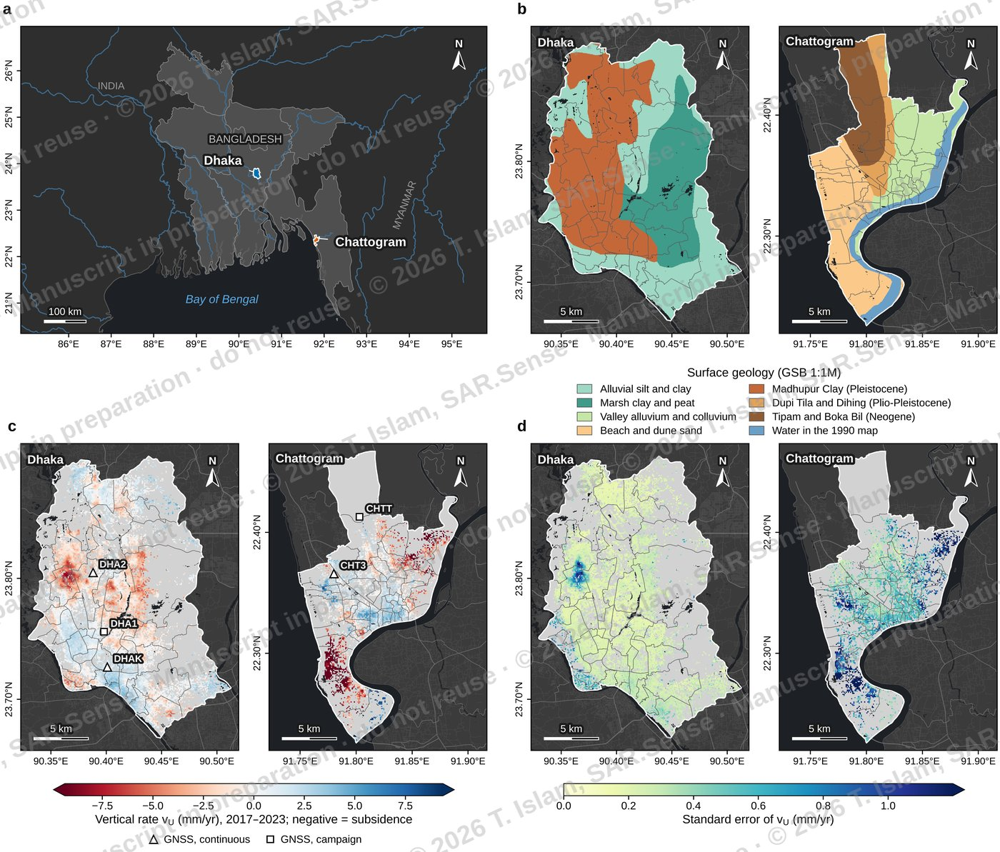
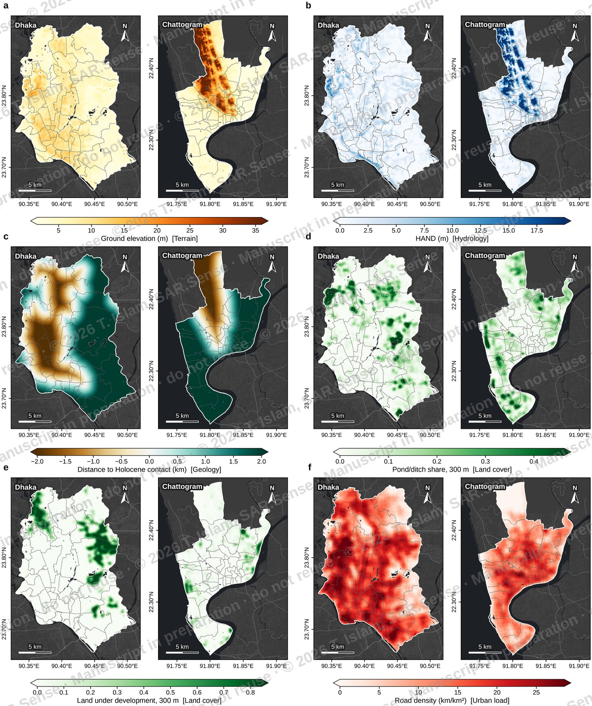
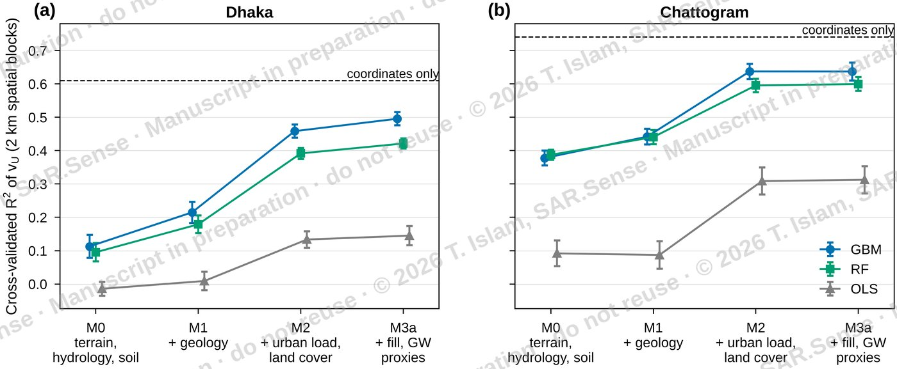

# Do the drivers of urban subsidence transfer between cities?

**Explainable machine learning on Sentinel-1 PS-InSAR in Dhaka and Chattogram, Bangladesh**

Towhidul Islam · SAR.Sense Geointelligence Lab, Chittagong · work in progress (manuscript in preparation)

> The figures on this page are previews of a paper that has not been published yet.
> They are reduced in resolution and watermarked. Please don't reuse or cite them.

Dhaka and Chattogram are both sinking, but probably not for the same reasons. In this project
I try to work out what controls where the ground goes down in each city, and whether a model
trained on one city still works when you move it to the other. The target is the vertical
velocity (vU, 2017-2023) from my Sentinel-1 PS-InSAR processing, checked against GNSS and
aggregated to 100 m cells. The deformation data itself is on the
[Bangladesh Ground Motion Observatory](https://github.com/TowhidulIslam27/bGMO).

*Fig. 1. (a) Location; (b) surface geology; (c) vertical velocity vU at the PS cells, with the GNSS
stations used for validation; (d) standard error of vU.*

## Questions

1. How much of the subsidence pattern can the factors explain when the model is tested on parts
   of the city it hasn't seen? I add them in groups: terrain, hydrology and soil (M0), then
   geology (M1), then urban load and land cover (M2), then fill history and groundwater (M3).
2. Which factors matter, and in what way? This part uses SHAP.
3. If I train in Dhaka, can I predict Chattogram, and the other way round? Only factors that mean
   the same thing in both cities are allowed here.

## Where it stands

Both cities sit on the same 100 m grid, which covers the whole city corporation area: 68 443
cells in Dhaka (17 622 with a vU value) and 32 752 in Chattogram (5 142 with vU).

For each city I built about 64 candidate factors from FABDEM, JRC Global Surface Water, Landsat,
Dynamic World, Sentinel-2, Google Open Buildings, GHSL, OpenStreetMap, OpenLandMap, HYSOGs and the
1:1M geological map of the Geological Survey of Bangladesh, using Python and Earth Engine.

The factors are screened before any model sees vU. Layers coarser than 1 km go, as do near-constant
or very sparse ones and anything that behaves like a map coordinate. After that, pairs with
Spearman |rho| above 0.8 and factors with VIF above 10 are thinned out. Dhaka keeps 52 factors and
Chattogram 45; 40 of them are shared and go into the transfer test.

For the first question I fitted gradient-boosted trees, a random forest and a linear model on each
set, with spatial block cross-validation (2 km blocks, 5 folds, 10 repeats). I chose 2 km from the
residual semivariogram and also ran 1 km and 4 km blocks to see how much the scores move.

*Fig. 3. Six of the factors, Dhaka next to Chattogram.*

## First results

*Fig. 4. Cross-validated R2 of vU for each factor set (mean and s.d. over 10 repeats). The dashed line
is a model that only knows the coordinates of each cell.*

| Factor set (boosted trees) | Dhaka R2 | Chattogram R2 |
|---|---|---|
| M0 terrain, hydrology, soil | 0.11 | 0.38 |
| M1 + geology | 0.22 | 0.44 |
| M2 + urban load, land cover | 0.46 | 0.64 |
| M3a + fill history, groundwater proxies | 0.50 | 0.64 |
| Coordinates only | 0.61 | 0.74 |

The two cities behave differently. Terrain on its own already explains a good part of the pattern in
Chattogram, where the low ground subsides and the hills stay put. In Dhaka it explains almost
nothing, and most of the skill comes from urban load, land cover and fill history.

Each group adds skill in every repeat, and the order stays the same with 1, 2 and 4 km blocks. The
tree models beat the linear one by about 0.3 in R2, so the relationships are clearly not linear.

The coordinates-only model still does better than all the factors together. So part of the
subsidence follows a broad spatial pattern that none of the current factors pick up. In Dhaka my
guess is the cone of depression in the Dupi Tila aquifer, which is why the next model (M3b) adds
groundwater heads digitised from published piezometric maps. I kept the coordinates baseline in the
figure because without it the R2 values would look better than they are.

## Next steps

Groundwater heads for Dhaka (M3b), the SHAP analysis, the transfer test between the two cities,
susceptibility maps with an area of applicability, and a check at 50 m and 200 m.

## Code

The pipeline is in `code/`, one script per manuscript section ([code/README.md](code/README.md) lists
them). It needs NumPy, SciPy, pandas, scikit-learn and Matplotlib, and runs without GDAL. The Earth
Engine scripts export the satellite factors onto the same grid. I haven't included the input data or
the cell tables while the papers are in preparation.

| Step | Scripts |
|---|---|
| Grid and study area | `s31_*`, `s21_fig01_study_area.py` |
| Factors (terrain, geology, land cover, OSM, soil, Earth Engine) | `s32a` to `s32h`, `s32m1` |
| Factor catalogue and screening | `s32i`, `s32j`, `s32l` |
| Figures | `s51_*` |
| Models and cross-validation | `s52_models_rq1.py` |

## Reuse

This is ongoing work, shared so people can see what I'm doing and how. Please get in touch before
reusing any of the code or figures. I'll add a licence once the paper is out.

(c) 2026 Towhidul Islam · [portfolio](https://towhidulislam27.github.io/) · m.towhid92@gmail.com
